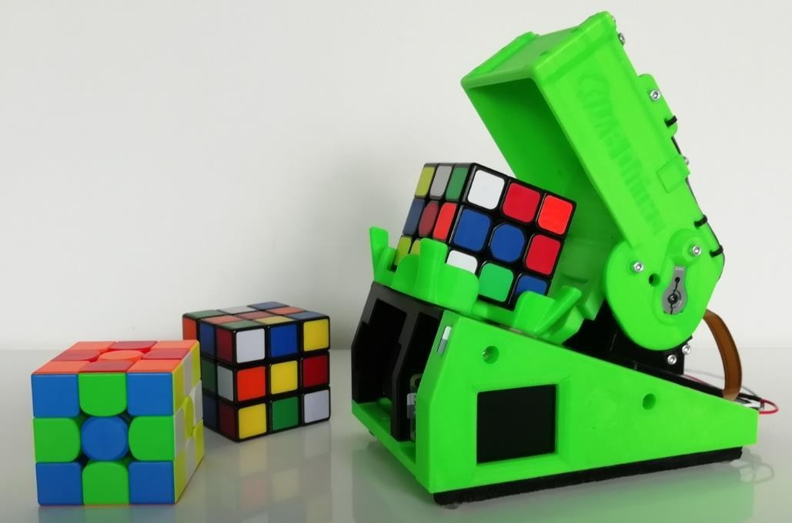

# CUBOTino Autonomous Rubik's Cube Solving Robot (Refurbished)



A compact 3D-printed robot that reads a scrambled 3x3 Rubik's cube with a Pi Camera and solves it with two servos. A Raspberry Pi Zero 2 W runs the colour detection and the two-phase solver on board. This is a refurbished remix of [CUBOTino Autonomous](https://github.com/AndreaFavero71/cubotino) by Andrea Favero.

## Install and build guide

A small 3D-printed robot that reads a scrambled 3x3 Rubik's cube with a camera and solves it with two servos. A Raspberry Pi Zero 2 W runs the colour detection and the two-phase solver on board, so no PC is needed after setup.

### 1. Print the parts

PETG is recommended (PLA works). About 700 g of filament and 50 hours of printing in total. The largest part, Structure, fits a 200 x 200 mm bed.

| File | Qty | Note |
|---|---|---|
| Structure | 1 | main frame |
| Top_cover | 1 | flips and holds the cube |
| Hinge | 1 | |
| Baseplate_front, Baseplate_rear | 1 each | |
| Cube_holder | 1 | rotating cube seat |
| Lifter | 1 | |
| Servo_axis_sup, Servo_axis_inf | 1 each | for 180 deg servos with 25T metal arms |
| Alternative_Servo_axis_sup / _inf | 1 each, instead of the above | for the alternative servo option |
| PCB_cover_display | 1 | micro-USB power version |
| PCB_cover_display_UsbC | 1, instead of the above | USB-C power version |
| PiCamera_holder_V1_V2_V3 | 1 | |
| Picamera_holder_frame | 1 | |
| Personaliz_plate or Personaliz_plate_01 | 1 | name plate, pick one |
| Extension_left, _middle, _right | 1 each, optional | only when you fit a full-size Raspberry Pi 2B/3B/4B instead of the Zero 2 W |

### 2. Electronics

- Raspberry Pi Zero 2 W with headers, 16 GB microSD, small heat sink.
- Pi Camera (V1.3, V2 or V3) with a 30 cm Pi Zero camera cable.
- 1.77 inch 128x160 SPI TFT with ST7735 driver.
- Two 25 kg metal-gear servos with 25T metal arms. 270 deg servos with a 500-2500 us pulse range (DS3225MG class) are the easiest choice; MG996R is the budget option.
- 3 W LED module, TTP223 touch pad, AMS1117-3.3 regulator, three 220 uF 16 V capacitors.
- Two micro-USB breakout boards (two 2 A chargers) or one USB-C breakout (one 3 A charger).
- A prototype board as the connections board, with 2x20 female header, 1x8 female header and right-angle male headers. A matching connections PCB can also be ordered from the project's Gerber files.

### 3. Assembly order

1. Set both servos to mid position before fitting the arms.
2. Fit the bottom servo and Cube_holder, then the Lifter.
3. Fit the top servo, Hinge and Top_cover with the M4 x 20 pivot screw.
4. Build and test the connections board, then fit it under PCB_cover_display with the display.
5. Mount the camera holder and frame, route the flex cable and close the base plates.

Screws: 1x M4 x 20, about 20x M3 x 12 cylinder head, about 30x M3 x 12 countersunk, 4x M2.5 x 10, 8x M2.5 x 4, 1x M2.5 x 20 with 4 nuts.

### 4. Software and tuning

Install Raspberry Pi OS on the Zero 2 W and run the CUBOTino installer from the project repository. Use the servo tuning GUI to set the open, close, flip and rotate positions, then the camera settings. Use a cube with a 56.0-57.5 mm side.

### Safety

Servos can pinch fingers. Keep hands away from the top cover while the robot runs and power it from adequate chargers only.

### Credits

Based on CUBOTino Autonomous by Andrea Favero, CC BY 4.0. Changes: combined print table and purchase list and a shorter build guide.

### Software and source links

- Prepare the microSD card as described in chapter 7 (steps 1-3) of the original build manual: `source/upstream/doc/How_to_make_CUBOTino_autonomous_robot_20260511.pdf` in this repository.
- On the Pi, over SSH: `git clone https://github.com/AndreaFavero71/cubotino.git`, then `cd cubotino/src`, `chmod +x install/setup.sh` and `sudo ./install/setup.sh`. Answer `y` to the reboot question at the end.
- Robot software, installer and servo tuning GUI (`Cubotino_T_servos_GUI.py`): `source/upstream/src/` in this repository.
- Connections board Gerbers and STEP files: `source/upstream/connections_board/` and `source/upstream/stp/` in this repository.

## Bill of Material

[Bill of Material (web page)](https://toolknox.github.io/hawkridge-cubotino-autonomous-rubiks-cube-robot/bill-of-material.html): open in the browser and click straight through to each part.

[Bill of Material (PDF)](docs/CUBOTino%20Cube%20Solving%20Robot%20-%20Bill%20of%20Material.pdf): every part to buy, with shop links.

## Documentation download

This repository is the documentation and source download for the build.

- **Download ZIP:** use GitHub's **Code → Download ZIP** button, or clone:

  ```bash
  git clone https://github.com/ToolKnox/hawkridge-cubotino-autonomous-rubiks-cube-robot.git
  ```

- **Build guide:** this README, also as [`docs/build-guide.md`](docs/build-guide.md).
- **Print files (STL, 20 parts):** [`source/upstream/stl/`](source/upstream/stl/)
- **Editable CAD (STEP):** [`source/upstream/stp/`](source/upstream/stp/)
- **Original full build manual (PDF):** [`source/upstream/doc/How_to_make_CUBOTino_autonomous_robot_20260511.pdf`](source/upstream/doc/How_to_make_CUBOTino_autonomous_robot_20260511.pdf)
- **Robot software and installer:** [`source/upstream/src/`](source/upstream/src/)
- **Connections board Gerbers and notes:** [`source/upstream/connections_board/`](source/upstream/connections_board/)
- **Alternative display options:** [`source/upstream/personalizations/`](source/upstream/personalizations/)
- **Original upstream README:** [`source/upstream/README.md`](source/upstream/README.md)

## Repository contents

- `docs/`: the build guide and the upstream mirror manifest.
- `download-documentation/`: how to download this package.
- `images/`: cover image.
- `source/upstream/`: mirror of the upstream project at commit `7cd1ad6002df466603e3c86713795f1dde25e065`, with the STL and STEP files, the robot software and installer, the connections board files and the original build manual.

## Credits and license

Remix of [CUBOTino Autonomous](https://github.com/AndreaFavero71/cubotino) by Andrea Favero, Creative Commons Attribution 4.0 International (CC BY 4.0). Mirrored from commit [`7cd1ad6`](https://github.com/AndreaFavero71/cubotino/tree/7cd1ad6002df466603e3c86713795f1dde25e065). The cover photo is taken from the original build PDF in `source/upstream/doc/`. The upstream license is kept at [`LICENSE`](LICENSE) and [`source/upstream/LICENSE`](source/upstream/LICENSE). No endorsement by the original authors is implied.

Changes by Hawkridge, updated for modern use: one combined purchase list, a combined print table with the variant parts and a shorter build guide in build order. Files under `source/upstream/` are unmodified.
